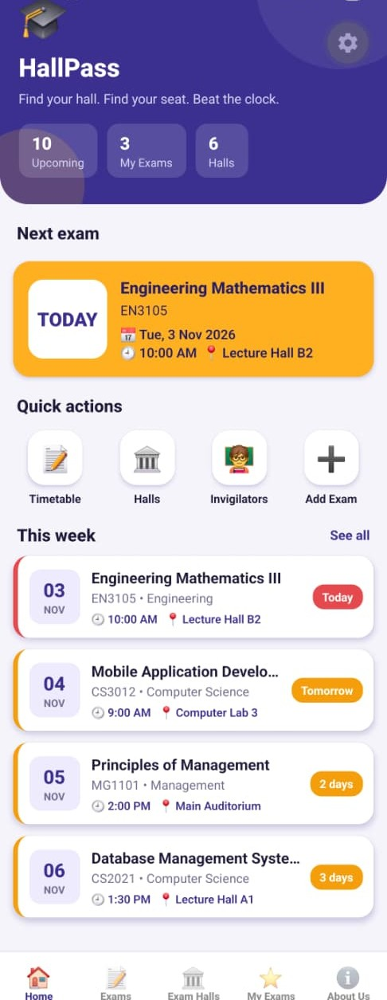
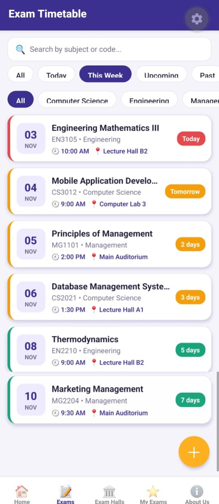
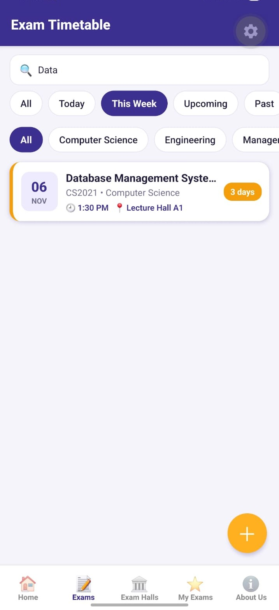
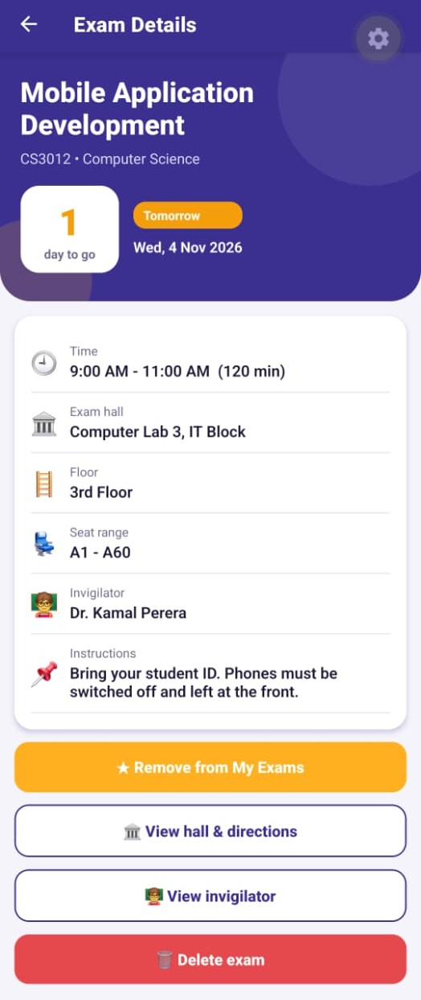
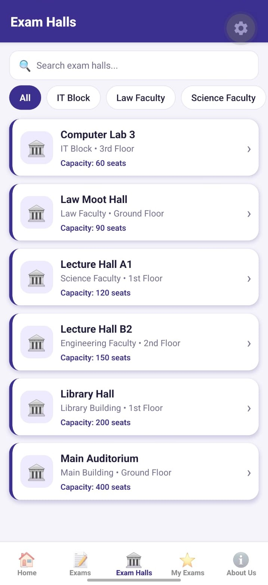
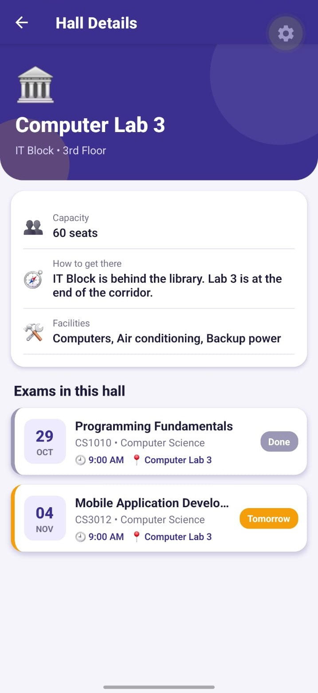
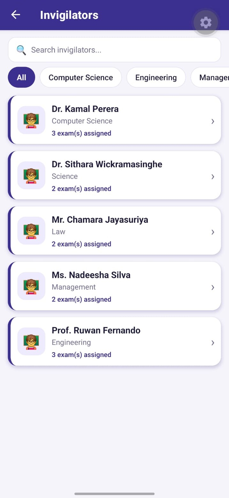
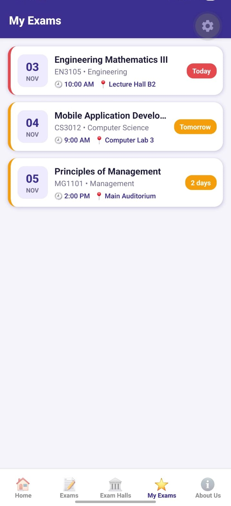
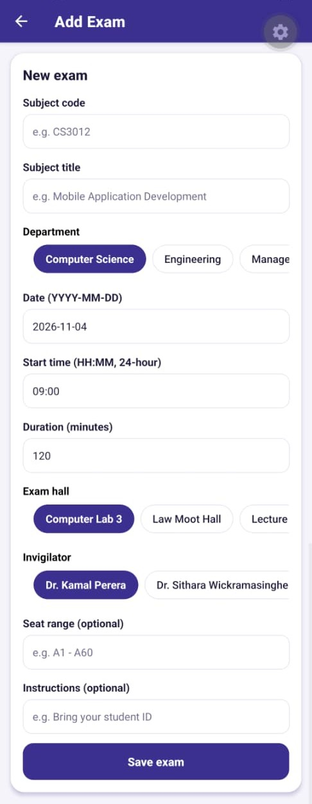
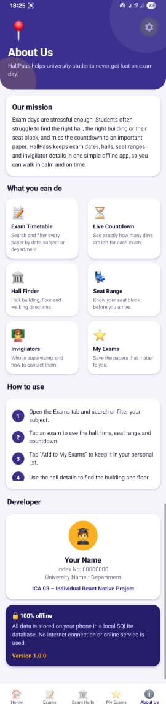

# 🎓 HallPass

### ExamHall Locator: Exam Seat, Hall & Invigilator Planner

**HallPass** is an offline mobile application built with **React Native (Expo)** that helps university students find their exam hall, seat range, invigilator and time, with a live countdown showing how many days are left for each paper.

> **Course:** ICA 03 – Individual React Native Project
> **Index No:** 2022/ICT/80

---

## 📖 Problem Statement

During exam periods, students often:

- struggle to find the correct hall or building,
- forget the exact date, time or seat block of a paper,
- lose track of how many days are left before an exam,
- do not know who the invigilator is or how to contact them.

HallPass keeps all of this information in one simple app that works **without an internet connection**.

---

## ✨ Features

- **Home dashboard** with the next exam countdown, quick actions and this week's exams.
- **Exam timetable** with search by subject name or code.
- **Filters** by period (Today, This Week, Upcoming, Past) and by department.
- **Exam details** with date, time range, hall, floor, seat range, invigilator and instructions.
- **Days-left countdown** with colour-coded status (green, amber, red, grey).
- **Exam halls** list with search and building filter, plus walking directions and facilities.
- **Hall details** showing every exam scheduled in that hall.
- **Invigilators** list with search and department filter, with contact details and assigned exams.
- **My Exams** list for saving the papers you care about.
- **Add and delete exams** using a validated form.
- **About Us** page explaining the app, how to use it and the developer.
- **100% offline**: no internet, public API or online database.

---

## 📱 Screens

| #   | Screen                  | Description                                                       |
| --- | ----------------------- | ----------------------------------------------------------------- |
| 1   | **Home**                | Next exam countdown, statistics, quick actions, this week's exams |
| 2   | **Exam Timetable**      | Searchable and filterable list of all exams                       |
| 3   | **Exam Details**        | Full information, countdown, save and delete actions              |
| 4   | **Exam Halls**          | Searchable list of halls with building filter                     |
| 5   | **Hall Details**        | Directions, facilities and exams in the hall                      |
| 6   | **Invigilators**        | Searchable list with department filter                            |
| 7   | **Invigilator Details** | Contact details and assigned exams                                |
| 8   | **My Exams**            | Saved exams                                                       |
| 9   | **Add Exam**            | Form to add a new exam                                            |
| 10  | **About Us**            | App information and developer details                             |

### 📸 App Screenshots

|                       Home                       |                       Exam Timetable                       |                       Exam Search                       |
| :----------------------------------------------: | :--------------------------------------------------------: | :-----------------------------------------------------: |
|  |  |  |

|                       Exam Details                       |                    Exam Halls                     |                       Hall Details                       |
| :------------------------------------------------------: | :-----------------------------------------------: | :------------------------------------------------------: |
|  |  |  |

|                       Invigilators                       |                       My Exams                       |                       Add Exam                       |
| :------------------------------------------------------: | :--------------------------------------------------: | :--------------------------------------------------: |
|  |  |  |

|                       About Us                       |
| :--------------------------------------------------: |
|  |

---

## 🛠️ Tech Stack

| Technology       | Purpose                                 |
| ---------------- | --------------------------------------- |
| React Native     | Mobile UI framework                     |
| Expo             | Development tooling and Expo Go support |
| expo-sqlite      | Local SQLite database                   |
| React Navigation | Bottom tabs and stack navigation        |

---

## 🗄️ Database Design

Data is stored locally in an SQLite database (`examhall.db`). The tables are created and filled with sample data automatically on the first launch.

### `halls`

| Column     | Type         | Description           |
| ---------- | ------------ | --------------------- |
| id         | INTEGER (PK) | Hall ID               |
| name       | TEXT         | Hall name             |
| building   | TEXT         | Building              |
| floor      | TEXT         | Floor                 |
| capacity   | INTEGER      | Number of seats       |
| directions | TEXT         | How to reach the hall |
| facilities | TEXT         | Facilities available  |

### `invigilators`

| Column     | Type         | Description     |
| ---------- | ------------ | --------------- |
| id         | INTEGER (PK) | Invigilator ID  |
| name       | TEXT         | Full name       |
| department | TEXT         | Department      |
| phone      | TEXT         | Phone number    |
| email      | TEXT         | Email address   |
| office     | TEXT         | Office location |

### `exams`

| Column         | Type         | Description                  |
| -------------- | ------------ | ---------------------------- |
| id             | INTEGER (PK) | Exam ID                      |
| code           | TEXT         | Subject code                 |
| title          | TEXT         | Subject title                |
| department     | TEXT         | Department                   |
| exam_date      | TEXT         | Date (`YYYY-MM-DD`)          |
| start_time     | TEXT         | Start time (`HH:MM`)         |
| duration_min   | INTEGER      | Duration in minutes          |
| hall_id        | INTEGER (FK) | References `halls.id`        |
| invigilator_id | INTEGER (FK) | References `invigilators.id` |
| seat_range     | TEXT         | Seat block                   |
| instructions   | TEXT         | Exam instructions            |
| is_saved       | INTEGER      | `1` if saved in My Exams     |

**Relationships:** one hall can host many exams, and one invigilator can supervise many exams.

The demo exam dates are generated relative to the day the app is first opened, so the countdowns always look realistic.

---

## 📂 Project Structure

```
HallPass/
├── App.js                       # Database provider + navigation
├── app.json                     # App name: "HallPass"
├── package.json
├── assets/
└── src/
    ├── theme.js                 # Colours and shadow
    ├── ui.js                    # Reusable UI components
    ├── utils.js                 # Date, time and countdown helpers
    ├── db/
    │   ├── database.js          # Table creation and seeding
    │   └── seed.js              # Local dataset
    ├── navigation/
    │   └── AppNavigator.js
    └── screens/
        ├── HomeScreen.js
        ├── ExamsScreen.js
        ├── ExamDetailScreen.js
        ├── HallsScreen.js
        ├── HallDetailScreen.js
        ├── InvigilatorsScreen.js
        ├── InvigilatorDetailScreen.js
        ├── MyExamsScreen.js
        ├── AddExamScreen.js
        └── AboutScreen.js
```

---

## 🚀 Getting Started

### Prerequisites

- [Node.js](https://nodejs.org/) (LTS)
- The **Expo Go** app on your phone (or an Android emulator)

### Installation

```bash
git clone https://github.com/FathimaAtheeka/hallpass-exam-hall-planner-2022ict80.git
cd hallpass-exam-hall-planner-2022ict80
npm install
npx expo start
```

Scan the QR code with **Expo Go**. The app opens as **HallPass**. Your phone and computer must be on the same Wi-Fi network for the first load.

### Reset the database

Clear the app data in Expo Go (or reinstall) and reopen the app to recreate the sample data.

---

## ✅ ICA 03 Requirements Checklist

| Requirement                            | How it is met                                                                |
| -------------------------------------- | ---------------------------------------------------------------------------- |
| Individual React Native application    | Built by me using Expo                                                       |
| Unique project title                   | HallPass: ExamHall Locator: Exam Seat, Hall & Invigilator Planner            |
| At least 5 screens                     | 10 screens                                                                   |
| Navigation between screens             | Bottom tabs + stack navigation (React Navigation)                            |
| Own dataset stored locally             | Custom dataset in `src/db/seed.js`, stored in SQLite                         |
| Retrieve and display data dynamically  | Every screen reads from SQLite using SQL queries                             |
| Searching, filtering and detail views  | Search and filters on exams, halls and invigilators; detail screens for each |
| Works without internet                 | No APIs or online services                                                   |
| GitHub repository with regular commits | Source code and history in this repository                                   |

---

## 🔮 Future Improvements

- Local notifications the evening before an exam.
- Edit existing exams.
- Dark mode.
- Campus map with hall locations.

---

## 👤 Author

**FathimaAtheeka** — Index No: 2022/ICT/80
GitHub: [FathimaAtheeka](https://github.com/FathimaAtheeka)

## 📄 License

Created for educational purposes as part of a university assignment.
